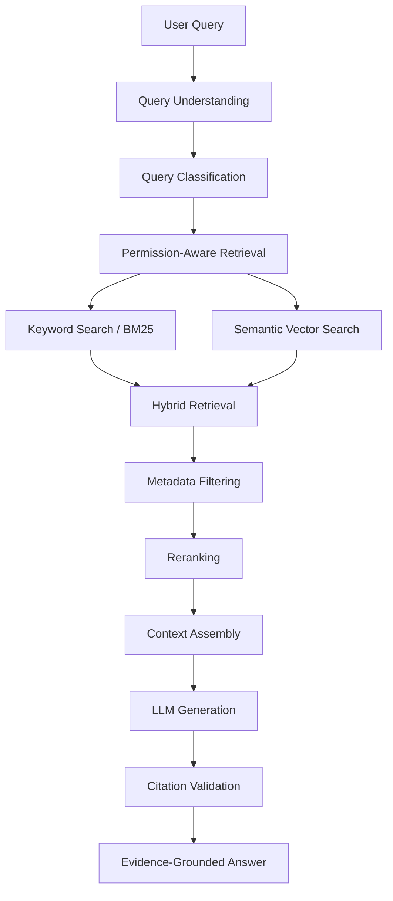
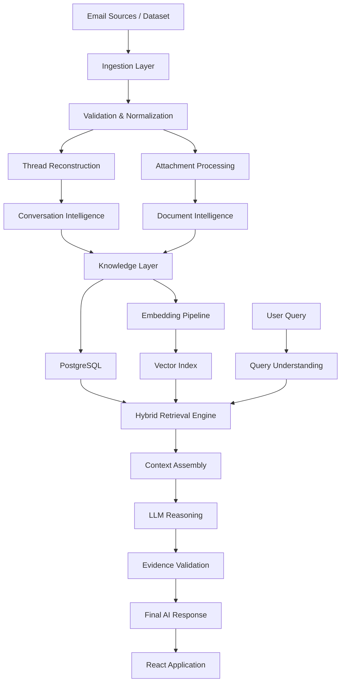

# SUTRA — Every Connection. One Intelligence. 🧠

### AI-Powered Institutional Email Intelligence Platform

> Transforming fragmented conversations into connected, searchable, and actionable institutional knowledge.

<p align="center">
  
  
  
  
</p>

<p align="center">
  <em>Inspired by the Sanskrit word सूत्र (Sutra) — a thread that connects knowledge, ideas, and meaning.</em>
</p>

---

## 📑 Table of Contents

- [1. Introduction](#-1-introduction)
- [2. The Problem](#-2-the-problem)
- [3. Our Solution](#-3-our-solution)
- [4. Core Capabilities](#-4-core-capabilities)
- [5. AI & RAG Architecture](#-5-ai--rag-architecture)
- [6. System Architecture](#-6-system-architecture)
- [7. Technology Stack](#-7-technology-stack)
- [8. Benchmark Dataset](#-8-benchmark-dataset)
- [9. Project Structure](#-9-project-structure)
- [10. Getting Started](#-10-getting-started)
- [11. Evaluation](#-11-evaluation)
- [12. Security & Reliability](#-12-security--reliability)
- [13. Development Roadmap](#-13-development-roadmap)
- [14. Our Vision](#-14-our-vision)

---

## 🚀 1. Introduction

**SUTRA** is an AI-powered institutional email intelligence platform designed to transform unstructured organizational communication into structured, contextual, and actionable knowledge.

Every organization generates thousands of emails containing important decisions, approvals, discussions, responsibilities, deadlines, and supporting documents.

Yet, finding the complete context behind a single decision often requires manually searching through multiple conversations.

SUTRA aims to eliminate this fragmentation by combining Large Language Models (LLMs), Retrieval-Augmented Generation (RAG), hybrid search, and structured information extraction.

### What SUTRA enables

- Understand complete email conversations rather than isolated messages.
- Reconstruct relationships between replies and forwarded messages.
- Generate contextual summaries of lengthy discussions.
- Extract decisions, approvals, responsibilities, and deadlines.
- Identify pending and completed actions.
- Answer natural-language questions across email collections.
- Provide evidence-backed answers with references to original emails.

**We are not building another email client. We are building an intelligence layer for organizational communication.**

---

## ⚠️ 2. The Problem

Institutional communication is rich in information but fragmented in structure.

Consider a typical procurement process:

1. A department submits a purchase request.
2. Vendors provide quotations.
3. Technical teams evaluate proposals.
4. Authorities approve the purchase.
5. Accounts confirms budget availability.
6. A purchase order is issued.
7. Delivery and installation are completed.

Every stage may exist in a different email or attachment.

Now imagine asking:

- Who approved the purchase?
- What was the final approved amount?
- Which vendor was selected?
- What is the latest status?
- Which tasks are still pending?
- Which emails support the final decision?

Traditional email search returns messages, but users must still reconstruct the complete story themselves.

### The fundamental challenges

| Challenge | Impact |
|---|---|
| Fragmented conversations | Important context is scattered |
| Context loss | Individual emails do not reveal the complete outcome |
| Hidden decisions | Approvals and responsibilities remain buried |
| Manual tracking | Pending actions are difficult to monitor |
| Limited search | Keyword search struggles with contextual questions |
| Lack of evidence | Answers are difficult to verify |

**The problem is not simply managing emails. It is understanding the knowledge hidden inside them.**

---

## 💡 3. Our Solution

SUTRA transforms disconnected email communication into a unified institutional knowledge layer.

Our approach combines five core capabilities:

**1. Connect**

Reconstruct email threads and organize related conversations.

**2. Understand**

Analyze complete conversations to understand their context and evolution.

**3. Extract**

Identify decisions, approvals, deadlines, responsibilities, and action items.

**4. Retrieve**

Use semantic and keyword-based retrieval to find relevant information.

**5. Verify**

Generate answers grounded in original emails and supporting documents.

### Our Core Differentiation

| Traditional Email Search | SUTRA |
|---|---|
| Searches individual messages | Understands complete conversations |
| Matches keywords | Understands contextual meaning |
| Requires manual interpretation | Extracts structured decisions |
| Leaves tasks buried | Identifies pending actions |
| Returns search results | Generates contextual answers |
| Provides limited traceability | Connects answers to evidence |

---

## 🧩 4. Core Capabilities

### 📥 A. Intelligent Email Ingestion

- CSV and structured email ingestion.
- Metadata extraction and normalization.
- Duplicate detection.
- Sender and recipient identification.
- Timestamp standardization.
- Attachment discovery and processing.

### 🧵 B. Conversation Intelligence

- Email thread reconstruction.
- Parent-child message relationships.
- Chronological conversation ordering.
- Participant identification.
- Topic organization.
- Latest conversation status.

### 📝 C. AI Summarization

Generate structured conversation summaries containing:

- Original purpose.
- Important discussion points.
- Chronological developments.
- Decisions and approvals.
- Latest status.
- Pending actions.
- Supporting email references.

### 🎯 D. Decision Intelligence

Extract:

- Final decisions.
- Approvals and rejections.
- Decision-making authority.
- Approval dates.
- Financial amounts.
- Supporting evidence.

### ✅ E. Action Intelligence

Identify:

- Action items.
- Responsible individuals.
- Deadlines.
- Pending tasks.
- Completed tasks.
- Completion evidence.

### 📎 F. Document Intelligence

- Attachment processing.
- Document text extraction.
- OCR for scanned documents.
- Table extraction.
- Document indexing.
- Attachment-to-email relationships.

### 🔎 G. Natural-Language Intelligence

Ask questions such as:

- Who approved the CNC machine procurement?
- What was the final approved amount?
- Which applications are currently on hold?
- What is the latest status of equipment maintenance?
- Did the examination date change?
- Which actions are still pending?

### 📚 H. Evidence-Grounded Answers

- Original email references.
- Thread identification.
- Source metadata.
- Supporting attachment references.
- Citation validation.
- Insufficient-evidence handling.

---

## 🧠 5. AI & RAG Architecture

SUTRA uses a modular AI architecture rather than treating the entire application as a single chatbot.

### Intelligence Components

| Component | Responsibility |
|---|---|
| Query Understanding | Interpret natural-language questions |
| Thread Intelligence | Understand complete conversations |
| Summarization Engine | Generate contextual summaries |
| Decision Extraction | Identify approvals and decisions |
| Action Extraction | Identify tasks, owners and deadlines |
| Hybrid Retrieval | Retrieve relevant email information |
| RAG Generation | Generate evidence-grounded answers |
| Citation Validation | Verify supporting sources |

### Hybrid RAG Pipeline

A central engineering principle of SUTRA is combining semantic understanding with exact information retrieval.



### Why Hybrid RAG?

Different questions require different retrieval strategies:

- Exact email IDs require precise lookup.
- Names and financial amounts benefit from keyword retrieval.
- Conceptual questions require semantic understanding.
- Latest-status questions require chronological reasoning.
- Complex questions may require retrieving evidence from multiple messages.

Combining these techniques provides a stronger foundation for institutional email intelligence.

### Our Grounding Principle

**An AI-generated answer is only useful when its supporting evidence can be verified.**

SUTRA is designed to avoid fabricated facts, unsupported citations, and misleading conclusions.

---

## 🏗️ 6. System Architecture

SUTRA follows a modular architecture that separates ingestion, data management, AI processing, retrieval, and user interaction.



### Architectural Principles

- Preserve original email data.
- Maintain email-to-thread relationships.
- Separate source data from AI-generated information.
- Preserve metadata throughout retrieval.
- Combine structured and vector-based search.
- Validate generated answers against source evidence.
- Design modules for independent evolution.

---

## 💻 7. Technology Stack

The following is our proposed technology stack. Final versions and dependencies will be established during implementation.

### Frontend

| Technology | Purpose |
|---|---|
| React | User interface |
| TypeScript | Type safety |
| Tailwind CSS | Styling |
| Framer Motion | Animations |

### Backend

| Technology | Purpose |
|---|---|
| Python | AI and application logic |
| FastAPI | Backend APIs |
| Pydantic | Data validation |
| SQLAlchemy | Database interaction |

### AI / ML

| Technology | Purpose |
|---|---|
| LLM APIs | Language understanding and generation |
| Embedding Models | Semantic representations |
| LangChain / LlamaIndex | RAG orchestration where useful |
| LangGraph | Controlled agent workflows where useful |
| Cross-Encoders | Reranking |

### Data & Infrastructure

| Technology | Purpose |
|---|---|
| PostgreSQL | Structured data |
| pgvector / Qdrant | Vector retrieval |
| BM25 | Keyword retrieval |
| Redis | Optional caching and job coordination |
| Docker | Containerization |
| Git & GitHub | Version control |

Technology selection will prioritize reliability, maintainability, and actual project requirements.

---

## 📊 8. Benchmark Dataset

SUTRA's initial development is grounded in the official problem-statement benchmark.

### Dataset Overview

| Component | Quantity |
|---|---:|
| Email Messages | 52 |
| Email Threads | 10 |
| Sample Queries | 15 |
| Evaluation Cases | 9 |
| Email Data Fields | 9 |
| Supporting Attachments | 9 |

The supplied benchmark contains fictional institutional communication.

### Benchmark Scenarios

| Thread | Scenario | Main Challenge |
|---|---|---|
| THR-001 | CNC Procurement | Vendor selection and approvals |
| THR-002 | Bonafide Certificates | Application status |
| THR-003 | Technical Fest | Event coordination |
| THR-004 | UTM Maintenance | Financial calculations |
| THR-005 | AI Seminar | Information retrieval |
| THR-006 | Faculty Reimbursement | Claim lifecycle |
| THR-007 | Department Printers | Procurement tracking |
| THR-008 | Examination Timetable | Change detection |
| THR-009 | Research Budget | Approval scope reasoning |
| THR-010 | Network Outage | Incident resolution |

### Important Evaluation Challenges

The benchmark tests whether SUTRA correctly understands:

- Approval versus completion.
- Budget acceptance versus purchase authorization.
- Partial changes to schedules.
- Multiple financial expenses.
- Pending versus completed tasks.
- Historical versus latest status.

These scenarios will guide our retrieval and reasoning evaluation.

---

## 📂 9. Project Structure

Proposed repository organization:

```text
SUTRA/
│
├── frontend/
│   ├── src/
│   │   ├── components/
│   │   ├── layouts/
│   │   ├── pages/
│   │   ├── features/
│   │   ├── services/
│   │   └── types/
│   └── package.json
│
├── backend/
│   ├── app/
│   │   ├── api/
│   │   ├── core/
│   │   ├── auth/
│   │   ├── ingestion/
│   │   ├── email_processing/
│   │   ├── thread_intelligence/
│   │   ├── attachments/
│   │   ├── summarization/
│   │   ├── decision_intelligence/
│   │   ├── action_intelligence/
│   │   ├── retrieval/
│   │   ├── rag/
│   │   ├── citations/
│   │   └── database/
│   └── requirements.txt
│
├── dataset/
│   ├── emails.csv
│   ├── sample_queries.csv
│   ├── evaluation_cases.csv
│   └── attachments/
│
├── evaluation/
│   ├── retrieval/
│   ├── summarization/
│   ├── extraction/
│   └── rag/
│
├── docs/
│   ├── PRD.md
│   └── architecture/
│
├── infrastructure/
├── .env.example
├── .gitignore
└── README.md
```

---

## ⚙️ 10. Getting Started

SUTRA is currently under active development. The following is the initial environment setup; complete run instructions will be added as the application components are implemented.

### Prerequisites

- Git
- Python 3.10+
- Node.js LTS
- PostgreSQL
- LLM API credentials
- Vector retrieval infrastructure

### Clone the Repository

```bash
git clone https://github.com/YOUR_USERNAME/SUTRA.git

cd SUTRA
```

### Backend Setup

```bash
cd backend

python -m venv venv

# macOS / Linux
source venv/bin/activate

# Windows
# venv\Scripts\activate

pip install -r requirements.txt
```

### Frontend Setup

```bash
cd frontend

npm install
```

### Environment Configuration

Create environment files from the provided examples.

Never commit API keys, database passwords, or other secrets.

The complete application startup commands will be documented once the services are finalized.

---

## 🔐 11. Security & Reliability

Institutional communication can contain sensitive information. Security is a core requirement of SUTRA.

Our design principles include:

- Authentication and role-based access control.
- Organization-level data isolation.
- Permission-aware search and retrieval.
- Secure attachment access.
- Encryption in transit and at rest.
- Environment-based secret management.
- Audit logging.
- Data retention and deletion policies.
- Protection against prompt injection.
- Validation of AI-generated information.

**A user must never access restricted institutional information through an AI-generated answer or citation.**

---

## 📈 12. Evaluation

SUTRA follows the official problem-statement evaluation framework.

| Evaluation Criterion | Weight |
|---|---:|
| RAG Response Accuracy & Source Grounding | 25% |
| Information Retrieval Accuracy | 20% |
| Conversation Summarization | 15% |
| Decision & Action Extraction | 15% |
| Usability & Practical Applicability | 15% |
| Thread Reconstruction & Topic Organization | 10% |
| **Total** | **100%** |

Our engineering evaluation will include:

- Precision@K and Recall@K.
- Mean Reciprocal Rank.
- Answer correctness.
- Citation precision and completeness.
- Summary factual consistency.
- Decision extraction accuracy.
- Action-item extraction accuracy.
- Retrieval and response latency.

All performance claims will be based on reproducible testing rather than assumptions.

---

## 🛣️ 13. Development Roadmap

| Phase | Focus | Key Deliverables |
|---|---|---|
| 01 | Foundation | Ingestion, normalization, thread reconstruction |
| 02 | Email Intelligence | Summaries, decisions, action extraction |
| 03 | Core RAG | Embeddings, vector search, basic RAG |
| 04 | Advanced Retrieval | BM25, hybrid search, reranking |
| 05 | Advanced AI | Evidence validation, multi-step reasoning |
| 06 | Product Development | Dashboard, AI workspace, evidence explorer |
| 07 | Evaluation | Benchmark testing and optimization |

---

## 🌍 14. Our Vision

SUTRA begins with institutional email intelligence, but our long-term ambition is to build a broader intelligence infrastructure for organizations.

Potential future directions:

- Unified organizational knowledge.
- Enterprise document intelligence.
- Institutional memory.
- Controlled AI workflow automation.
- Predictive organizational insights.
- Multi-organization enterprise intelligence.

These are future directions, not claims of existing functionality.

We believe organizations should spend less time searching for information and more time using the knowledge they already possess.

---

<p align="center">

# SUTRA

### Every Connection. One Intelligence.

**Indian Roots. Global Intelligence.**

*Connecting conversations. Preserving knowledge. Empowering decisions.*

Made with ❤️ and a vision for meaningful AI.

</p>

<p align="center">
<sub>SUTRA — AI-Powered Institutional Email Intelligence Platform</sub><br/>
<sub>Currently under development.</sub>
</p>
