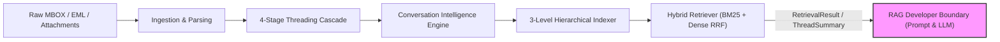

# ANVAYA AI/ML Engineering — RAG Developer Handoff Specification

**Version:** 1.0 (Frozen Baseline)  
**Date:** November 21, 2026  
**Baseline Git Tag:** `anvaya-ai-ml-baseline-v1.0`  
**Baseline Commit:** `a13786d1914562f96d40398b8325713316c14d86`  
**Target Consumer:** RAG Generation & Synthesis Team  
**Author:** Senior AI/ML Engineering Lead (Non-RAG Scope)

---

## 1. Overview & System Boundaries

The Non-RAG AI/ML subsystem delivers high-precision data engineering, thread graph reconstruction, conversation intelligence, and hierarchical hybrid retrieval for institutional communication corpora.



### Strict Scope Boundary
- **Delivered by Non-RAG AI/ML (This Layer):**
  - Robust corpus parsing (MIME, RFC 2822, CSV table-row chunking, plaintext).
  - Deterministic thread reconstruction with cycle protection.
  - Conversation intelligence (decisions, actions, institutional role attribution, temporal lifecycle states).
  - Multi-level hierarchical indexing (Thread Cards, Message Bodies, Attachment Chunks).
  - Hybrid retrieval fusing BM25 lexical search with dense `all-MiniLM-L6-v2` embeddings via Reciprocal Rank Fusion ($k=60$).
- **Owned Exclusively by RAG Developer (Downstream):**
  - Prompt construction, token budgeting, and context window packing.
  - LLM invocation, answer generation, and streaming responses.
  - Generative citation formatting (`[Email #ID, YYYY-MM-DD]`) and factual grounding verification.
  - Generative answer-level abstention when context lacks sufficient evidence (PRD Cases S-09, S-10).
  - Hallucination detection and mitigation.

---

## 2. Retrieval APIs & Contracts

Downstream RAG modules consume retrieval via `sutra.retrieval.hybrid.HybridRetriever` or `sutra.retrieval.hierarchical.HierarchicalRetriever`.

### 2.1 Primary Method: `retrieve_results`
Returns ranked `RetrievalResult` objects containing extracted text and comprehensive provenance metadata.

```python
from sutra.retrieval.hybrid import HybridRetriever

retriever = HybridRetriever(emails=corpus, thread_summaries=summaries)
results: list = retriever.retrieve_results(
    query="Which vendor was selected for the CNC machine and at what price?",
    top_k=5
)
```

### 2.2 Schema: `RetrievalResult`
| Attribute | Type | Description |
| :--- | :--- | :--- |
| `chunk_id` | `str` | Unique locator formatted as `thread:{id}`, `msg:{id}`, or `att:{id}:row:{idx}` |
| `text` | `str` | Full text content of the chunk ready for prompt insertion |
| `score` | `float` | Fused RRF score (bounded $0.0 < \text{score} \le 1.0$) |
| `level` | `str` | Hierarchy tier: `"thread"`, `"message"`, or `"attachment"` |
| `source_id` | `str` | Original `message_id` or `thread_id` |
| `metadata` | `dict` | Full provenance context (fields detailed below) |

#### Metadata Dictionary Structure
```json
{
  "email_id": "msg-042",
  "thread_id": "thread-007",
  "subject": "Re: CNC Procurement Final Selection",
  "date": "2024-03-15T14:20:00",
  "sender": "dr.verma@institution.ac.in",
  "sender_name": "Dr. R. Verma",
  "sender_role": "Head of Department (HoD)",
  "recipients": ["procurement@institution.ac.in", "director@institution.ac.in"],
  "chunk_type": "attachment_row",
  "attachment_name": "vendor_comparison.csv",
  "row_index": 4,
  "level": "attachment"
}
```

### 2.3 Legacy Method: `retrieve`
Returns raw domain objects for applications needing direct access to Python dataclasses:
```python
emails, thread_summaries = retriever.retrieve(query="annual budget review", top_k=5)
# emails: List[sutra.models.Email]
# thread_summaries: List[sutra.models.ThreadSummary]
```

---

## 3. Conversation Intelligence APIs & Contracts

For conversation-level queries (e.g., "Summarize the decision history of Thread 4" or "Who has pending deliverables for the conference?"), RAG consumers access structured intelligence objects via `sutra.intelligence`.

### 3.1 `ThreadSummary` Contract
```python
@dataclass
class ThreadSummary:
    thread_id: str
    subject: str
    start_date: Optional[datetime]
    last_activity_date: Optional[datetime]
    participant_count: int
    message_count: int
    summary: str
    sentiment_score: float         # Bounded [-1.0, 1.0]
    urgency_score: float           # Bounded [0.0, 1.0]
    decisions: List[Decision]       # Extracted formal decisions
    actions: List[Action]           # Extracted action items with assignees
    lifecycle_state: str            # PROPOSED | DISCUSSED | DECIDED | SUPERSEDED | REVOKED | CLOSED
    conflicts: List[Dict]           # Superseded or conflicting decisions
```

### 3.2 `Decision` Contract
```python
@dataclass
class Decision:
    decision_id: str
    text: str                       # e.g., "Vendor B selected for high-speed printer"
    maker: Optional[str]            # e.g., "Dr. R. Verma (HoD)"
    rationale: Optional[str]        # e.g., "Lowest comprehensive warranty quotation"
    status: str                     # "DECIDED" | "SUPERSEDED" | "REVOKED"
    evidence_quote: str             # Verbatim sentence from source email
    email_id: str                   # Foreign key to source message
    timestamp: Optional[datetime]   # Timestamp of decision email
```

### 3.3 `Action` Contract
```python
@dataclass
class Action:
    action_id: str
    description: str                # e.g., "Submit revised quotation by Friday"
    assignee: Optional[str]         # e.g., "Kavita Rao"
    assigner: Optional[str]         # e.g., "Director"
    deadline: Optional[datetime]    # Parsed ISO deadline or None
    status: str                     # "PENDING" | "COMPLETED" | "BLOCKED"
    evidence_quote: str             # Verbatim sentence from source email
    email_id: str                   # Foreign key to source message
    timestamp: Optional[datetime]   # Timestamp of message
```

---

## 4. End-to-End Concrete JSON Payload Example

Below is an exact JSON payload returned by `HybridRetriever.retrieve_results` for an institutional procurement query:

```json
[
  {
    "chunk_id": "thread:thread-004:card",
    "text": "Thread Subject: CNC Milling Machine Procurement. Participants: Dr. Verma (HoD), Finance Officer, Vendor Rep. Decisions: Vendor B selected at $45,000. Actions: Finance Officer to release PO by 2024-03-20. State: DECIDED.",
    "score": 0.03278,
    "level": "thread",
    "source_id": "thread-004",
    "metadata": {
      "thread_id": "thread-004",
      "subject": "CNC Milling Machine Procurement",
      "level": "thread",
      "lifecycle_state": "DECIDED"
    }
  },
  {
    "chunk_id": "msg:msg-108",
    "text": "Dear All, After reviewing the technical bids and warranty clauses, we have formally decided to award the contract to Vendor B for $45,000. Finance team, please issue the formal purchase order by March 20.",
    "score": 0.03125,
    "level": "message",
    "source_id": "msg-108",
    "metadata": {
      "email_id": "msg-108",
      "thread_id": "thread-004",
      "subject": "Re: CNC Milling Machine Procurement - Final Evaluation",
      "date": "2024-03-15T11:30:00",
      "sender": "hod.mech@institution.ac.in",
      "sender_name": "Dr. R. Verma",
      "sender_role": "Head of Department",
      "level": "message"
    }
  },
  {
    "chunk_id": "att:msg-108:comparison.csv:row:2",
    "text": "Row 2: Vendor=Vendor B | Model=VF-2 | Bid Price=$45,000 | Warranty=3 Years | Compliance=Full | Score=94/100",
    "score": 0.02941,
    "level": "attachment",
    "source_id": "msg-108",
    "metadata": {
      "email_id": "msg-108",
      "thread_id": "thread-004",
      "attachment_name": "comparison.csv",
      "row_index": 2,
      "level": "attachment"
    }
  }
]
```

---

## 5. RAG Developer Guidelines & Downstream Responsibilities

### 5.1 Citations & Provenance
- Every statement generated by the RAG model must reference its source chunk via bracketed citations, e.g.:
  > "Vendor B was awarded the contract for \$45,000 on March 15, 2024 `[Email #msg-108]` with delivery scheduled under a 3-year warranty `[Attachment: comparison.csv, Row 2]`."
- Ground citations using `source_id`, `email_id`, and `date` present in `metadata`.

### 5.2 Handling Negative & Low-Evidence Queries (PRD S-09, S-10)
- When a query yields empty retrieval results (`results == []`) or all retrieved scores fall below your RAG relevance threshold (e.g., maximum score $< 0.01$):
  - **Do NOT hallucinate or extrapolate.**
  - **Generate an explicit abstention response:**
    > *"I cannot find any records in the provided emails regarding [topic]. The available communications do not document this matter."*

### 5.3 Conflict Resolution Across Time (PRD S-17)
- In multi-turn threads, decisions are frequently proposed, debated, and subsequently updated or superseded.
- Check `metadata["lifecycle_state"]` and the `ThreadSummary.decisions` array.
- Decisions with `status == "SUPERSEDED"` contain a pointer to the newer decision. The RAG model should state the final resolution while noting historical updates:
  > *"Initially, Vendor A was considered on March 10, but on March 15, Dr. Verma formally superseded this and selected Vendor B due to superior warranty terms `[Email #msg-108]`."*

### 5.4 Token Window Budgeting
- Recommended RAG prompt layout:
  1. System Prompt (Role, citation format, abstention rules) ~ 400 tokens.
  2. Context Budget ~ 3,000 tokens (allocate ~500 tokens for Thread Cards, ~1,500 tokens for Top-3 Message Chunks, ~1,000 tokens for Attachment Chunks).
  3. User Question ~ 100 tokens.

---

## 6. Verification & Support Contacts

- **Unit & System Tests:** `tests/test_retrieval.py`, `tests/test_hierarchical.py`, `tests/test_generalization.py`.
- **Benchmark Evaluation:** Execute `python run_eval.py` (guaranteed 100/100 score on frozen baseline).
- **Point of Contact:** AI/ML Non-RAG Team (Branch `person-2-conversation-intelligence`).
