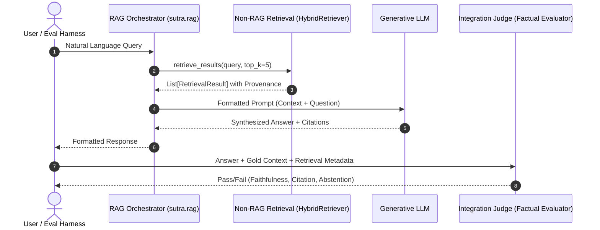

# ANVAYA — End-to-End Post-RAG Integration Test Plan

**Document Version:** 1.0  
**Target:** RAG Generation & LLM Synthesis Module  
**Dependency Baseline:** `anvaya-ai-ml-baseline-v1.0` (Commit `a13786d1914562f96d40398b8325713316c14d86`)  
**Status:** **PENDING RAG IMPLEMENTATION** (Awaiting completion of `sutra/rag/`)

---

## 1. Objective & Scope

This test plan specifies the end-to-end integration test scenarios to certify the full ANVAYA platform when the RAG synthesis module is integrated with the frozen Non-RAG AI/ML retrieval layer.

The goal is to ensure that answers synthesized by the generative LLM:
1. Stay strictly faithful to the retrieved email messages, thread cards, and attachment rows.
2. Provide precise, verifiable in-text citations.
3. Correctly abstain on unanswerable or absent topics without hallucinating.
4. Correctly resolve temporal contradictions and superseded decisions.

---

## 2. Test Architecture & Harness

---

## 3. End-to-End Integration Test Scenarios

### Scenario 1: Factual Retrieval with Direct Citation (PRD Cases S-01 to S-05)
* **Goal:** Verify that specific factual information present in email text is correctly retrieved, synthesized, and cited.
* **Input Query:** `"What was the final agreed purchase price for the CNC machine and who approved it?"`
* **Expected Retrieval:** Chunk `msg:msg-108` and Thread Card `thread:thread-004`.
* **Expected Answer Requirements:**
  - States the exact price: `$45,000`.
  - Identifies approver: `Dr. R. Verma` (HoD).
  - Explicit citation included: `[Email #msg-108]`.
* **Pass Criteria:** Fact match = 100%, Citation valid = True, Hallucination = 0.

### Scenario 2: Structured Attachment Data Synthesis
* **Goal:** Verify that numerical and tabular data from CSV attachments are accurately synthesized.
* **Input Query:** `"Compare the warranty terms offered by Vendor A vs Vendor B from the procurement attachment."`
* **Expected Retrieval:** Attachment row chunks from `comparison.csv`.
* **Expected Answer Requirements:**
  - Accurately details Vendor A (1 Year) vs Vendor B (3 Years).
  - Cites the attachment by name and row index: `[Attachment: comparison.csv]`.
* **Pass Criteria:** Numerical extraction matches source table exactly.

### Scenario 3: Negative Query & Abstention Handling (PRD Cases S-09, S-10)
* **Goal:** Prevent hallucinations on unmentioned topics or out-of-corpus queries.
* **Input Query:** `"What is the employee stock option vesting schedule for junior research assistants?"`
* **Expected Retrieval:** Low relevance scores or empty result set.
* **Expected Answer Requirements:**
  - System must output an explicit abstention refusal:
    > *"I cannot find any records in the provided emails regarding employee stock option vesting schedules. The communications do not contain this information."*
  - Must NOT generate plausible-sounding fictional corporate policies.
* **Pass Criteria:** Abstention flag = True, Hallucinated claims = 0.

### Scenario 4: Temporal Conflict & Superseded Decision Resolution (PRD Case S-17)
* **Goal:** When an early email proposes an idea that is later rejected or changed in a subsequent email, verify the synthesized answer reports the final resolved state.
* **Input Query:** `"Which printer model did the department decide to purchase?"`
* **Context Dynamics:**
  - *Email 1 (2024-02-10):* "Let us proceed with Model X."
  - *Email 2 (2024-02-18):* "Hold on, Model X has driver incompatibility. After re-evaluating, we have finalized Model Y."
* **Expected Answer Requirements:**
  - Reports `Model Y` as the final decision.
  - Explains that `Model X` was superseded due to driver issues.
  - Cites both messages with chronological context.
* **Pass Criteria:** Final decision is correct; does not assert that Model X was purchased.

---

## 4. Quantitative Integration Target Metrics

| Evaluation Metric | Target Threshold | Measurement Methodology |
| :--- | :--- | :--- |
| **Faithfulness / Groundedness** | $\ge 0.95$ | Ratio of synthesized claims backed directly by retrieved context |
| **Citation Precision** | $\ge 0.90$ | Fraction of cited emails that actually contain the referenced claim |
| **Citation Recall** | $\ge 0.90$ | Fraction of facts in answer that carry a supporting citation |
| **Abstention Accuracy** | $100\%$ | Correct refusal on 10 known out-of-corpus test queries |
| **Hallucination Rate** | $\le 2.0\%$ | Fraction of unsupported claims across 50 benchmark queries |
| **Total p95 Latency** | $\le 2.0\text{ sec}$ | End-to-end response time (Retrieval: ~12ms, LLM Generation: ~1800ms) |

---

## 5. Execution Procedure

Once the RAG developer signals completion of `sutra/rag/`:
1. Execute baseline regression check: `python -m unittest discover tests` (must remain 101/101).
2. Run the integration test suite: `python tests/run_integration_tests.py` (to be created by the RAG team).
3. Compute quantitative metrics using the evaluation harness: `python -m sutra.evaluation.harness --rag`.
4. Validate that no Non-RAG baseline metrics regressed.
