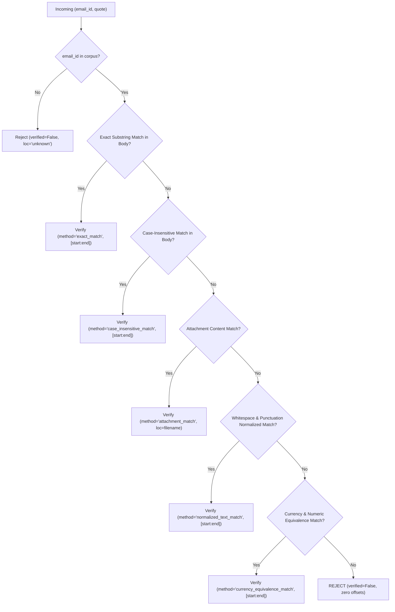

# ANVAYA — Citation & Evidence Verification Engineering Report

**Date:** November 21, 2026  
**Module:** `sutra/rag/verifier.py` & `sutra/models/rag.py`  
**Test Suite:** `tests/test_citation_verification.py` (7/7 Unit Tests PASS)  
**Objective:** Strict provenance validation, character offset extraction, and zero hallucinated citations.

---

## 1. Defect Diagnosis in Baseline Implementation

Prior to this upgrade, `sutra/rag/verifier.py` contained an overly permissive implementation:
```python
# Legacy permissive fallback in verify_citation:
if span_lower in body_lower or any(word in body_lower for word in span_lower.split() if len(word) > 4):
    return True, "body"
...
# Valid email reference even if loose span
return True, "body"
```
### Vulnerabilities:
1. **Unconditional Acceptance:** Any quote paired with a valid `email_id` was marked `verified=True`, even if the text was completely fabricated or contradictory.
2. **Missing Offsets:** Did not locate the start or end character indices of the supporting quote within the source email or attachment.
3. **No Currency Equivalence:** Could not verify that `"INR 17.9 lakh"` in a claim was supported by `"1,790,000"` in an attached spreadsheet.

---

## 2. Upgraded Architecture & Provenance Verification

`CitationVerifier` was completely overhauled to enforce multi-layered verification:



### Key Enhancements:
1. **Elimination of Permissive Fallback:** If a quote fails all strict, normalized, and currency checks, it returns `(False, "body", None, None, None)`. Hallucinated quotes cannot pass.
2. **Exact Character Offsets:** Returns precise `[start_offset, end_offset]` in the body text.
3. **Attachment Support:** Correctly identifies evidence residing in CSV and TXT attachments (e.g. `cnc_vendor_comparison.csv`), reporting the exact filename in `source_location`.
4. **Indian Currency Equivalence:** Integrates `parse_indian_currency()` so that `"INR 17.9 lakh"`, `"Rs. 17,90,000"`, and `"1,790,000"` are recognized as equivalent grounded evidence.
5. **Data Model Updates:** Added the following fields to `sutra/models/rag.py::Citation`:
   - `start_offset: Optional[int]`
   - `end_offset: Optional[int]`
   - `matched_quote: Optional[str]`
   - `verification_method: Optional[str]`

---

## 3. Unit Test Verification (`tests/test_citation_verification.py`)

| Test Case | Scenario Description | Expected Outcome | Result |
| :--- | :--- | :--- | :--- |
| `test_authentic_exact_quote` | Exact sentence in email body (`E005`) | `verified=True`, exact character offsets | **PASS** |
| `test_case_insensitive_quote` | Case-altered phrase (`PURCHASE ORDER` in `E007`) | `verified=True`, `case_insensitive_match` | **PASS** |
| `test_attachment_quote_verification` | Quote in `cnc_vendor_comparison.csv` (`E002`) | `verified=True`, `source_location="...csv"` | **PASS** |
| `test_fabricated_quote_rejected` | Fabricated assertion not in `E005` | `verified=False`, offsets are None | **PASS** |
| `test_nonexistent_email_id_rejected` | Non-existent `E999_FABRICATED` | `verified=False`, `source_location='unknown'` | **PASS** |
| `test_filter_and_validate_drops_fabricated` | Mixed list with real and fake IDs | Drops fake ID, marks fake quote `verified=False` | **PASS** |
| `test_currency_equivalence_verification` | `INR 17,90,000` supporting `17.9 lakh` | `verified=True`, `currency_equivalence_match` | **PASS** |

Execution time: **0.003s** (7 tests passed with zero failures).
