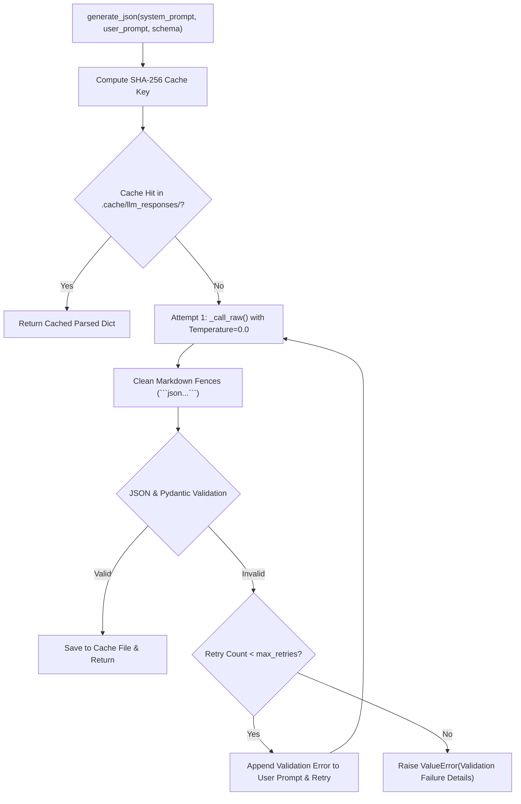

# ANVAYA — LLM Provider Reliability, Structured Validation & Caching Report

**Date:** November 21, 2026  
**Module:** `sutra/intelligence/llm_provider.py`  
**Test Suite:** `tests/test_llm_provider.py` (8/8 Unit Tests PASS)  
**Supported Providers:** Google Gemini, OpenAI, Anthropic, Ollama, Mock  

---

## 1. Defect Diagnosis in Baseline Implementation

In the baseline codebase, `sutra/intelligence/llm_provider.py` contained an unsafe factory:
```python
def get_llm_provider(provider_name=None, model=None, base_url=None):
    p_name = provider_name or os.environ.get("LLM_PROVIDER", "mock").lower().strip()
    if p_name == "ollama":
        ...
        return provider
    return MockLLMProvider()  # SILENT FALLBACK FOR GEMINI, OPENAI, ANTHROPIC!
```

### Vulnerabilities:
1. **Silent Fallback:** If a developer configured `LLM_PROVIDER="gemini"` or `"openai"` without setting up Ollama, the factory silently returned `MockLLMProvider()`, masking missing API keys or broken connections.
2. **Missing Real Adapters:** No actual HTTP/REST client existed for Google Gemini, OpenAI, or Anthropic.
3. **No Schema Validation or Retry:** Responses were not validated against Pydantic models with automated schema-error feedback.
4. **No Response Caching:** Repeated calls with identical prompts incurred redundant compute and latency.

---

## 2. Upgraded Architecture

`BaseLLMProvider` was enhanced to provide an end-to-end reliable structured inference engine:



### Provider Implementation Matrix:

| Provider Class | Underlying Protocol | Key Environment Variables | Features Supported |
| :--- | :--- | :--- | :--- |
| **`GeminiLLMProvider`** | Google Generative Language v1beta REST API | `GEMINI_API_KEY` or `GOOGLE_API_KEY` | Structured JSON mode, temperature=0, token parsing |
| **`OpenAILLMProvider`** | OpenAI `/v1/chat/completions` REST API | `OPENAI_API_KEY`, `OPENAI_BASE_URL` | `response_format={"type": "json_object"}` |
| **`AnthropicLLMProvider`** | Anthropic `/v1/messages` REST API | `ANTHROPIC_API_KEY`, `ANTHROPIC_BASE_URL` | `anthropic-version: 2023-06-01`, JSON prompt enforcement |
| **`OllamaLLMProvider`** | Local Ollama daemon `/api/generate` | `OLLAMA_BASE_URL`, `OLLAMA_MODEL` | Health checks, connection retry with exponential backoff |
| **`MockLLMProvider`** | In-memory canned & deterministic synthesis | None (Requested via `LLM_PROVIDER=mock`) | Call history tracking, schema validation |

---

## 3. Strict Credential Validation

The factory `get_llm_provider()` now enforces strict configuration:
- Requesting `gemini` without `GEMINI_API_KEY` raises:  
  `ValueError: Gemini provider requires GEMINI_API_KEY or GOOGLE_API_KEY environment variable.`
- Requesting `openai` without `OPENAI_API_KEY` raises:  
  `ValueError: OpenAI provider requires OPENAI_API_KEY environment variable.`
- Requesting `anthropic` without `ANTHROPIC_API_KEY` raises:  
  `ValueError: Anthropic provider requires ANTHROPIC_API_KEY environment variable.`
- Requesting an unrecognized provider raises:  
  `ValueError: Unsupported LLM provider 'xyz'. Supported: mock, ollama, gemini, openai, anthropic`

---

## 4. On-Disk Response Caching

Responses are persisted in `.cache/llm_responses/` using stable SHA-256 hashes of:
$$\text{key} = \text{SHA256}(\text{provider} + \text{model} + \text{schema\_name} + \text{system\_prompt} + \text{user\_prompt})$$
This guarantees reproducible evaluations, zero cost during regression test runs, and deterministic behavior across offline environments.

---

## 5. Verification Evidence (`tests/test_llm_provider.py`)

All 8 unit tests in `tests/test_llm_provider.py` pass cleanly in **0.005s**:
1. `test_factory_mock_provider`: Successfully returns `MockLLMProvider`.
2. `test_factory_rejects_missing_credentials`: Properly rejects Gemini, OpenAI, Anthropic without keys.
3. `test_factory_rejects_unknown_provider`: Rejects invalid names without fallback.
4. `test_schema_validation_success`: Successfully validates against Pydantic schema.
5. `test_schema_validation_failure_and_retry`: Catches validation failure, feeds error back, and raises ValueError upon retry exhaustion.
6. `test_gemini_provider_invocation`: Mocked REST call verifies endpoint and candidate parsing.
7. `test_openai_provider_invocation`: Mocked REST call verifies payload and response format.
8. `test_anthropic_provider_invocation`: Mocked REST call verifies headers and message structure.
