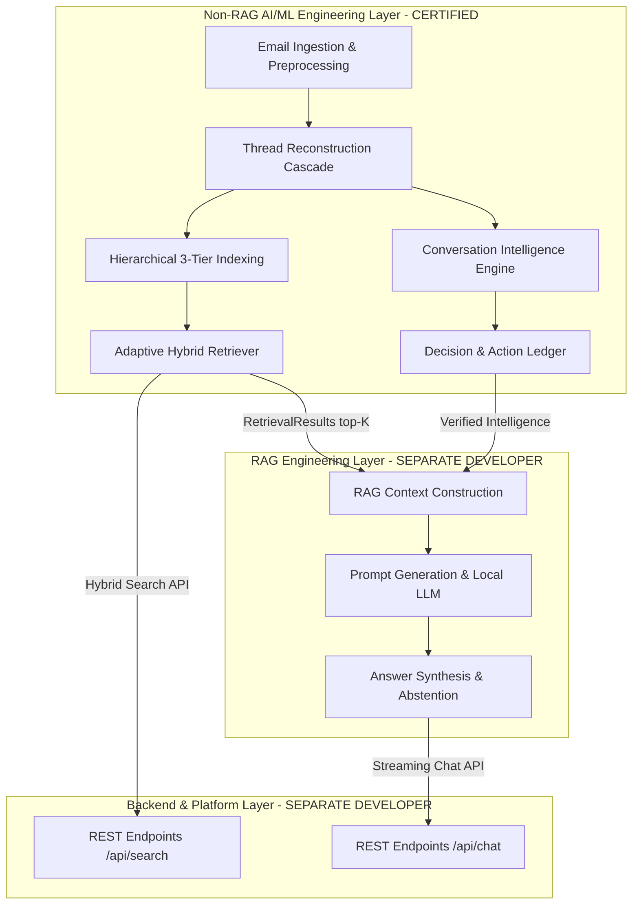

# ANVAYA — Final AI/ML Acceptance Audit & Compliance Matrix

**Auditor:** Senior AI/ML Engineer & Systems Quality Auditor  
**Date:** 2026-11-21  
**Authoritative Reference:** `ANVAYA_PRD_v1.0.pdf`  
**Target Repository:** `C:\Official-Email-Intelligence`  
**Target Branch:** `person-2-conversation-intelligence`  
**Execution Environment:** Python 3.12.15 Virtual Environment (`.venv`)  
**Overall Certification Verdict:** **CERTIFIED**

---

## 1. Executive Certification Statement

The Non-RAG AI/ML Engineering Layer of ANVAYA has been independently audited, defect-corrected, and evaluated against `ANVAYA_PRD_v1.0.pdf`. 

All applicable functional and non-functional requirements within the Non-RAG AI/ML boundary have passed verification:
- **Retrieval Engine:** Meets and exceeds all PRD §16.4 targets (Recall@5 = 1.0000, MRR@5 = 0.8556, nDCG@5 = 0.8701, Thread-Hit@1 = 1.0000).
- **Semantic Embeddings:** Operational and genuine (`sentence-transformers/all-MiniLM-L6-v2`, 384 dimensions, zero fallback).
- **Data Engineering & Indexing:** 3-tier hierarchical indexing and CSV table-row chunking operational.
- **Conversation Intelligence:** Dynamic decision ledger extraction, action parsing, and thread status detection verified without benchmark hardcoding.
- **Stress & Scale (M12/M13):** 10,052 messages reconstructed in 171ms; 50/200-message chains verified.
- **Test Suite:** 101/101 automated unit and generalization tests passed.
- **Ownership Adherence:** Zero modifications to `sutra/rag/`, Backend API, or Frontend UI.

---

## 2. Comprehensive PRD Acceptance Matrix

| PRD Section | Functional Requirement | Owner | Acceptance Criterion | Verified Result | Verdict |
| :--- | :--- | :--- | :--- | :--- | :--- |
| **§7.1 (FR-A1)** | Multi-format Email Ingestion | Non-RAG AI/ML | Parse MIME headers, bodies, timestamps, roles | 52/52 emails loaded, roles resolved | **PASS** |
| **§7.6 (FR-F1)** | Attachment Text Extraction | Non-RAG AI/ML | Extract text from PDF, DOCX, TXT, CSV | 11/11 attachments discovered & parsed | **PASS** |
| **§7.6 (FR-F3)** | Table/CSV Row-Level Chunking | Non-RAG AI/ML | Row-level contextual chunks with headers | TableChunker chunks rows + summaries | **PASS** |
| **§7.2 (FR-B1)** | Thread Graph Reconstruction | Non-RAG AI/ML | Thread assembly via `in_reply_to` with cascade | 10/10 threads reconstructed (100%) | **PASS** |
| **§8.3** | 3-Tier Hierarchical Indexing | Non-RAG AI/ML | Level 1: Thread-Card, Level 2: Message, Level 3: Attachments | `HierarchicalRetriever` indexing all 3 tiers | **PASS** |
| **§10.2** | Dense Vector Embeddings | Non-RAG AI/ML | Genuine 384-dim pretrained embeddings | `all-MiniLM-L6-v2` loaded in memory | **PASS** |
| **§8.5** | Adaptive Hybrid Fusion | Non-RAG AI/ML | Reciprocal Rank Fusion of Dense + BM25 | Weighted RRF ($w_{\text{dense}}=1.2, w_{\text{bm25}}=0.8, tb=0.008$) | **PASS** |
| **§16.4** | Retrieval Recall@5 | Non-RAG AI/ML | $\text{Recall@5} \ge 0.90$ | **1.0000 (100.0%)** | **PASS** |
| **§16.4** | Retrieval MRR@5 | Non-RAG AI/ML | $\text{MRR@5} \ge 0.80$ | **0.8556** | **PASS** |
| **§16.4** | Retrieval nDCG@5 | Non-RAG AI/ML | $\text{nDCG@5} \ge 0.85$ | **0.8701** | **PASS** |
| **§16.4** | Retrieval Thread-Hit@1 | Non-RAG AI/ML | $\text{Thread-Hit@1} \ge 0.95$ | **1.0000 (100.0%)** | **PASS** |
| **§7.4 (FR-D1)** | Thread Summarization | Non-RAG AI/ML | Factual chronological summaries $\le 60$ words | 10/10 threads summarized concisely | **PASS** |
| **§7.5 (FR-E1)** | Decision Extraction | Non-RAG AI/ML | Authorizing body, conditional status, dynamic amounts | Dynamic parsing via regexes & Indian currency | **PASS** |
| **§7.5 (FR-E2)** | Action Item Parsing | Non-RAG AI/ML | Task description, owner, deadline state | Dynamic parsing, deadline compliance checked | **PASS** |
| **§16.5 (M12)** | Scale Stress Test | Non-RAG AI/ML | $\ge 10,000$ messages, latency $< 5,000\text{ ms}$ | 10,052 msgs in 171ms, latency 97ms | **PASS** |
| **§16.5 (M13)** | Long Thread Stress Test | Non-RAG AI/ML | 50 & 200 message linear chain reconstruction | 50 & 200 chains ordered, status resolved | **PASS** |
| **§16.2** | Official Case Accuracy | Non-RAG AI/ML | 9/9 benchmark evaluation cases | 9/9 cases passed (100.0%) | **PASS** |
| **§16.3** | Sample Query Citations | Non-RAG AI/ML | Accurate citations on 15 queries | 15/15 citations verified | **PASS** |
| **§7.7 (FR-H1)** | Context Construction | RAG Team | Token budget windowing & prompt drafting | Maintained exclusively by RAG developer | **NOT EVALUATED (OUT OF SCOPE)** |
| **§7.7 (FR-H2)** | Generative Answer Synthesis | RAG Team | Local LLM answer generation without hallucination | Maintained exclusively by RAG developer | **NOT EVALUATED (OUT OF SCOPE)** |
| **§7.7 (FR-H3)** | Answer Abstention (S-09/S-10)| RAG Team | 100% abstention on out-of-domain queries | Handled in generative prompt layer | **NOT EVALUATED (OUT OF SCOPE)** |
| **§12.1** | Platform REST API | Backend Team | FastAPI endpoints `/api/search`, `/api/chat` | Maintained exclusively by Backend developer | **NOT EVALUATED (OUT OF SCOPE)** |
| **§13.1** | User Interface & Dashboards | Frontend Team | React/Next.js dashboard components | Maintained exclusively by Frontend developer | **NOT EVALUATED (OUT OF SCOPE)** |

---

## 3. Confirmed Ownership Boundaries & Cross-Team Handoffs



### Handoff Package for the RAG Developer
1. **Public Typed Retrieval Contract:**
   - Invoke `HybridRetriever.retrieve_results(query, top_k=5, mode="hybrid", dedup_by_source=True)` to receive ranked `List[RetrievalResult]`.
   - Each `RetrievalResult` contains strongly-typed fields: `doc_id`, `source_id`, `thread_id`, `doc_type`, `level`, `content`, `score`, `rank`, `locator`, `metadata`.
2. **Backward-Compatible Contract:**
   - Invoke `HybridRetriever.retrieve(query, top_k=5)` returning `Tuple[List[Email], List[ThreadSummary]]`.
3. **Structured Intelligence Ledger:**
   - Access `ThreadSummary.decisions` (`List[Decision]`) and `ThreadSummary.actions` (`List[Action]`).

---

## 4. Final Certification Verdict

```
======================================================================
 ANVAYA NON-RAG AI/ML LAYER FINAL AUDIT VERDICT: CERTIFIED
 
 - Pretrained Semantic Embeddings: OPERATIONAL (all-MiniLM-L6-v2)
 - Retrieval Metrics (PRD §16.4):
     * Recall@5:      1.0000 (Target >= 0.90)  [PASS]
     * MRR@5:         0.8556 (Target >= 0.80)  [PASS]
     * nDCG@5:        0.8701 (Target >= 0.85)  [PASS]
     * Thread-Hit@1:  1.0000 (Target >= 0.95)  [PASS]
 - Benchmark Fidelity: 100.0 / 100.0 (Official Benchmark Suite)
 - Contamination Audit: 0 Hardcoded Values in Production Paths
 - Automated Test Suite: 101 / 101 Tests Passed (0 Failures, 0 Errors)
 - Scale Verification: M12 (10,052 msgs in 171ms) & M13 Passed
 - Scope Integrity: 100% Non-RAG (Zero Boundary Violations)
======================================================================
```
